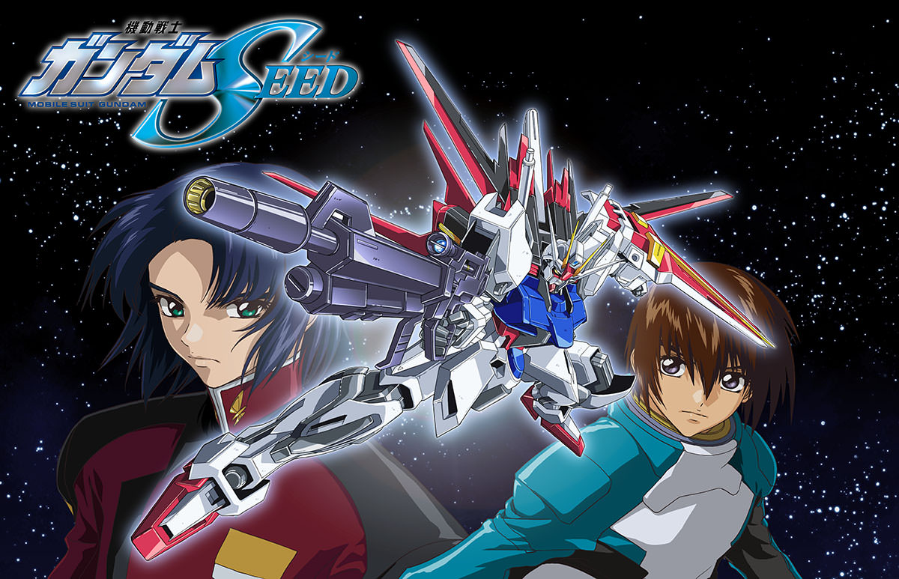

今日颱風，二刷Gundam Seed，還是好看！

豈止是好看，是年輕時吃的太好。24年過去了，Seed的內核仍然堪當整個Gundam系列的巔峰。單是反戰劇情的鋪陳，就足夠給全球向右的今日現實扇個響亮的巴掌。調整者與自然人陣營都出現了民粹領導，用名字好聽但行為恐怖的「為了藍色純淨的宇宙」洗腦。SEED營造了一個由歌姬、神武者和凡人組建的中立勢力，雖然對照現實世界仍然過於理想化了，但已經是極端狂熱世界難得的正常人（好人）。至於權貴二代自我覺醒鬧革命，陰差陽錯愛上朋友的戀人這些劇情，也是很照顧觀眾了。
