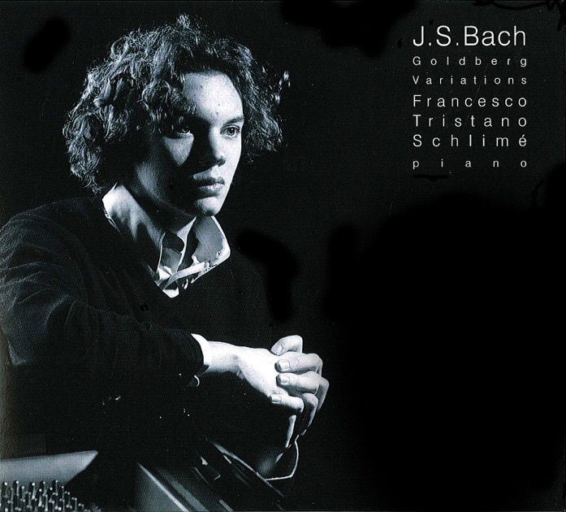

如果不是看坂本龍一《我還能看到多少次滿月升起》，還完全不知道年輕的Francesco Tristano早就錄過完整的Goldberg Variations。托Apple Music的福，很快找到了試聽，迫不及待地play第一首Aria詠嘆調，果然「老氣橫秋」，慢的那些地方很容易讓人想起Tureck和Gould。而切換到熟悉萬分的第4首變奏——不對啊，節奏和詮釋的聽感相當新穎，融合了jazz的恣意和自由感，節奏確實不快，琵音沒有按傳統巴洛克風格演奏得輕快靈巧，但情緒表達得流暢又飽滿。

是不是2002年先出的LP，而後2010年才有的Digital？音質很好，聲音兼有透明和重量感。

由於除了Apple Music，全網找不到資源，被迫啟用最傳統的模擬AA對錄大法。正好最近調整過了器材，一併記錄在這裡。

錄音機：ZOOM H4n  
DAC：Antelope Audio zeo  
信號線：VOVOX Initio IC Direct RCA 1m  
RCA - 6.35：SOMMER HICON  
RCA - 3.5 stero：eze便利電

