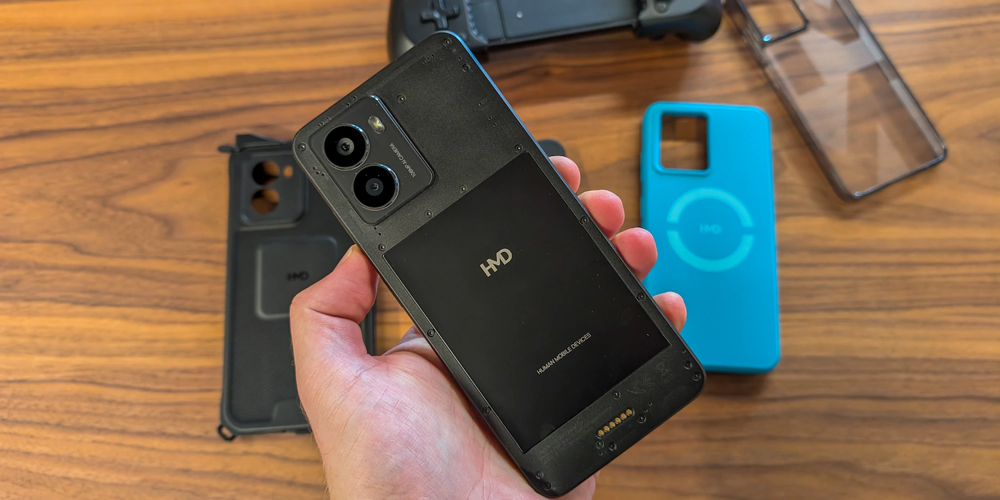

幾個月前，我花了點時間整理了一遍微信聯繫人，給將近2000人分了組，盡量備註上他們的聯繫手機，並編製了標準的通訊錄，以便於我在iOS和Android跨平台調用。

微信聊天記錄，從iPhone SE,3nd做了備份、在HMD Fusion做了恢復。

而HMD Fusion是什麼？它的主芯片不過區區Snapdragon 4 Gen 2，連運行微信都會有點卡幀。但我無所謂，還見人就說我換Nokia了，讓對方每次都要錯愕半天。

現在，這台「非主流」的HMD Fusion裝著我的大陸手機號，還是日常收發微信的主力機。因為是原生的Stock Android，我可以絕對信任它的系統純淨度，和對我隱私的絕對保（無）護（視）。它還保留了傳統的MicroSD擴展槽，方便我手動管理幾百GB的視訊和圖書資料。作為LCD星人，它的屏幕在我這兒絕對是護眼尤物。

因為手機性能的限制，我到現在還沒有對滑手機上癮，對tiktok，小紅書更是絕緣體質。

我記得我的第一支智能手機，是htc的G1，那是一台帶有滑蓋鍵盤的Android終端，之所以沒有選全觸屏的設備，是因為那時候聽說宮崎駿公開表示：「用手指在屏幕上點點戳戳的人類行為，實在不好看。」

>2010年7月，當時iPad問世不久。宮崎駿接受了吉卜力工作室出版的免費刊物《熱風》（Neppu）2010年7月號採訪，談到iPad。  
>當時他看到採訪者手持 iPad，說了一段相當尖銳的話：  
>「あなたが手にしている、そのゲーム機のようなものと、妙な手つきでさすっている仕草は気色わるいだけで、ぼくには何の関心も感動もありません。嫌悪感ならあります。」  
>「你手裡拿著的那個像遊戲機一樣的東西，以及用奇怪的手勢撫摸它的動作，在我看來只有令人不快。我對此毫無興趣，也毫無感動，只有厭惡。」  
>他接著說：  
>「その内に電車の中でその妙な手つきで自慰行為のようにさすっている人間が増えるんでしょうね。」  
>「恐怕不久之後，電車裡就會有越來越多的人，用那種奇怪的手勢，像自慰一樣撫摸它吧。」  

但是2026年了，我估計宮崎駿現在也沒那麼堅持當時的表態。倒是我自己覺得，管住自己的注意力，在自主思考和人機互動上保持平衡，屬於現代人一項被低估的修養。
