最近十多年，主力相機一直用Nikon：D3s，Df，D850，Z6，再早的還用過L35AF自動膠卷機。

聽說Nikon已經將公司總部和Nikon Museum尼康博物館從港區遷至品川區西大井，帶著好奇心，帶著Nikon Z6和Nikkor Z 24-70mm f4 S，前去Nikon大本營「朝聖」了。

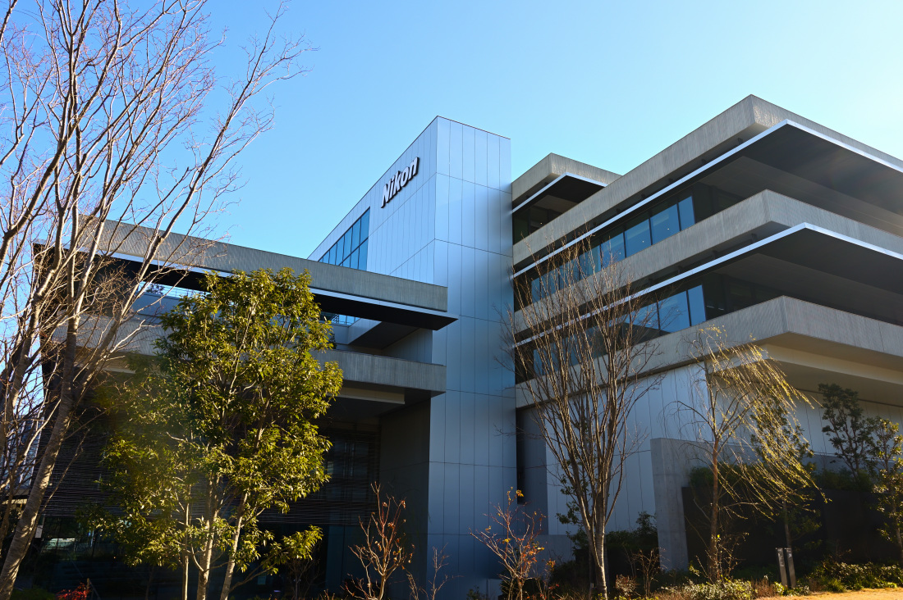

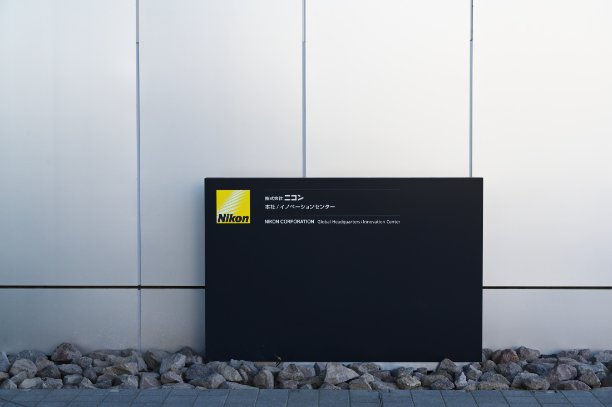

新的Nikon總部座落於西大井一片鬧中取靜的居民住宅群落間，同時這裡也是Nikon百年創業的「原點」，尼康在1918年（大正7年）在這裡設立了大井第一工廠。在Nikon Museum的歷史回顧小型展覽里，有專門的圖文資料提到了這段歷史。

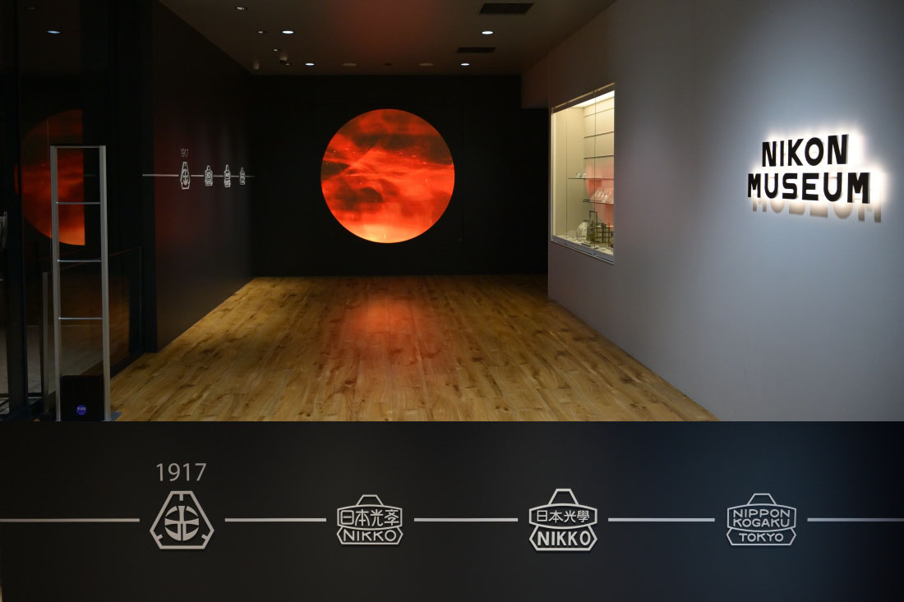

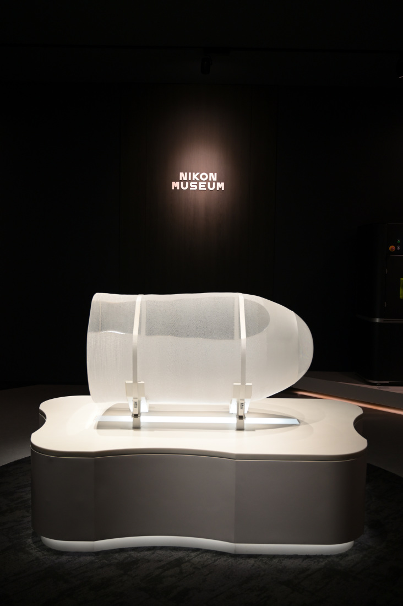

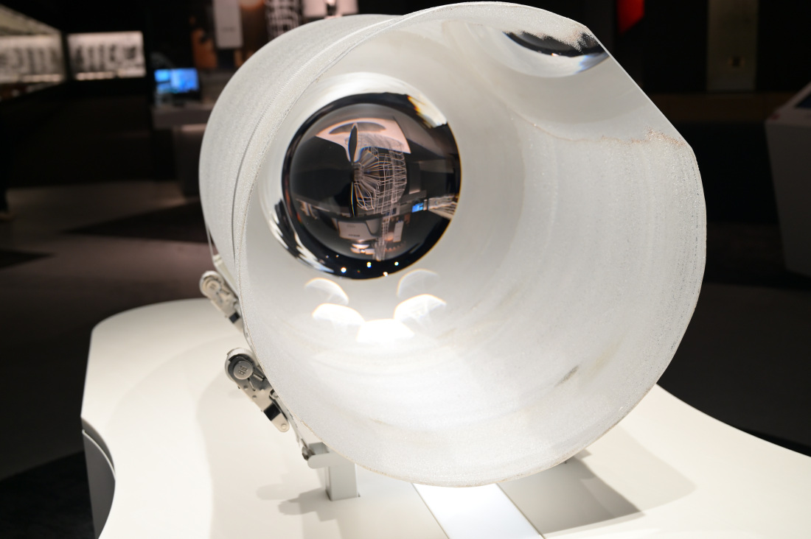

在工業品區，最耀眼的是巨型石英玻璃錠，最古老的是初代顯微鏡；光刻機展品不允許拍照。

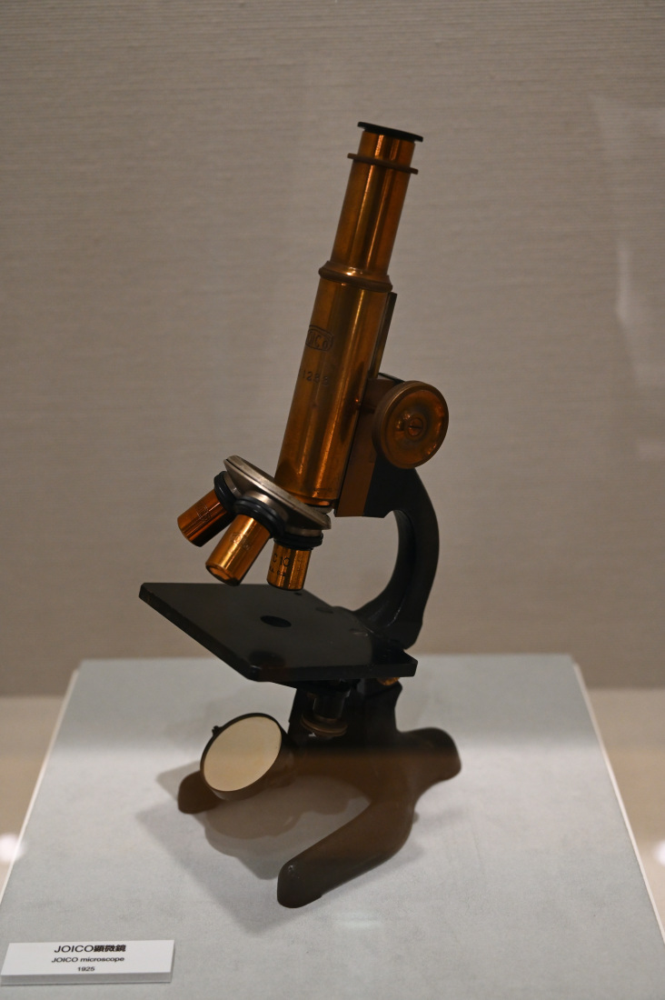

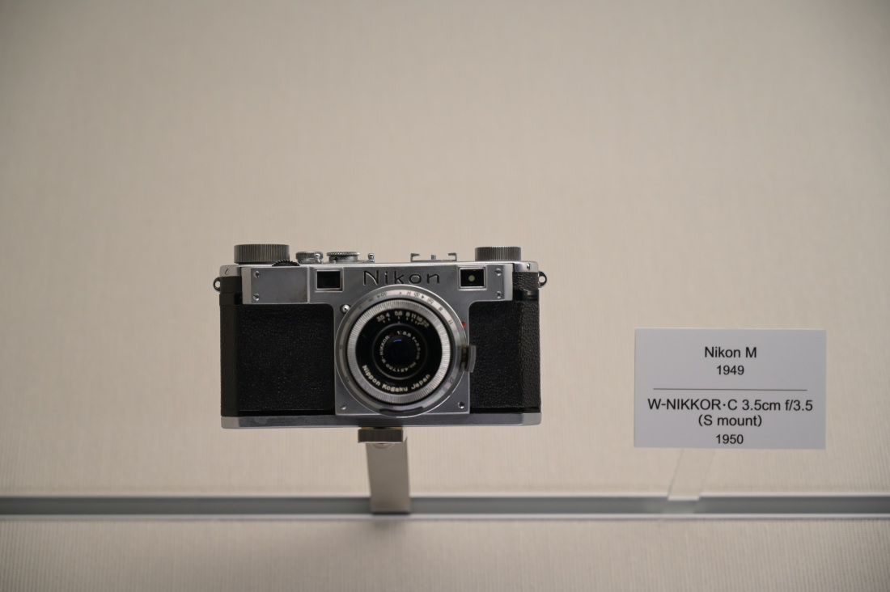

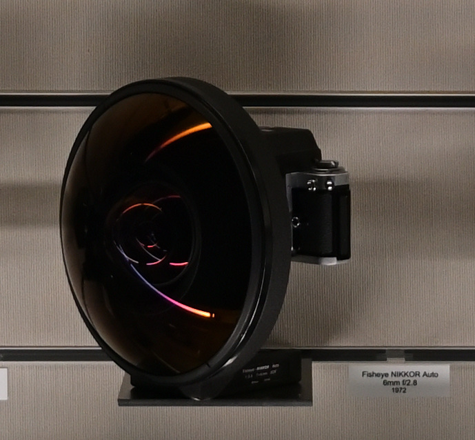

在消費品區，歷代相機機身、鏡頭，還有原型機、太空開發機型、雙筒望遠鏡整齊有序地鋪陳開來。老Nikon玩家津津樂道、且存世稀少的超級魚眼鏡頭6mm f2.8有實物陳列，稍有點可惜的是超長焦「大砲」1200-1700mm f5.6-8P ED IF 沒有陳列出來（可能被收進庫房了）。

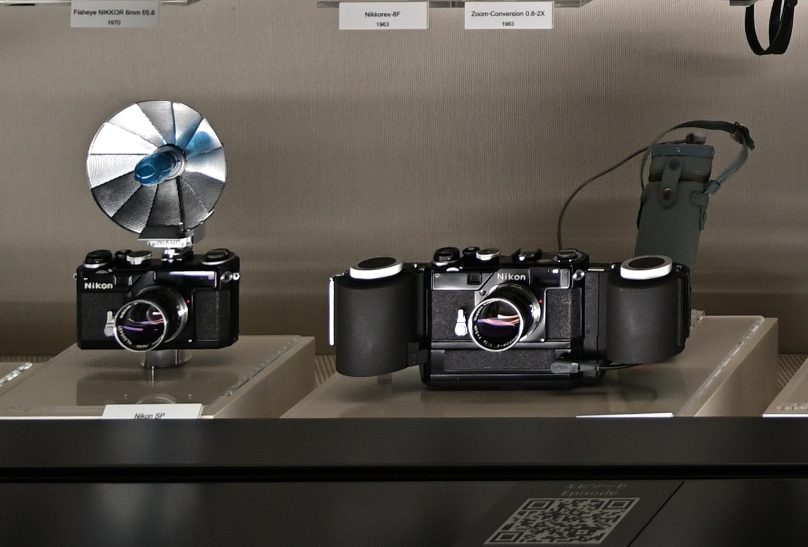

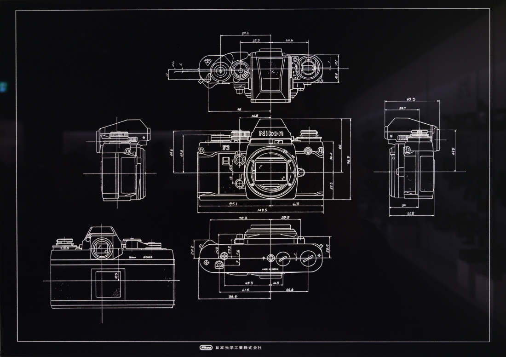

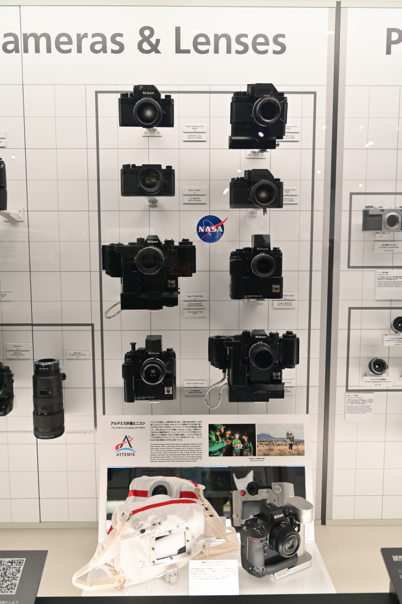

BANDAI萬代在2024年12月，曾經發售過一組Nikon扭蛋模型，有大F、SP、Zfc和Z9。上海尼康直營店（淮海中路）同步銷售過，我試了一次手氣，中的是SP；朋友forcecommand中的是大F。SP是Nikon旁軸相機的扛鼎之作，在Nikon Museum展示了一只搭載可拆卸電動馬達系統與大容量膠片後背的SP「大彈鼓」組合，同樣屬於極其罕見的藏品，低調炫耀了一把Nikon在旁軸時代就已經具備了高機動性、高容量、可擴展的相機設計製造能力。看到它，讓我對我的SP扭蛋更多了幾分敬意。

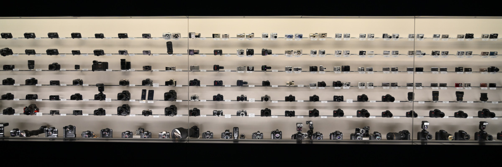

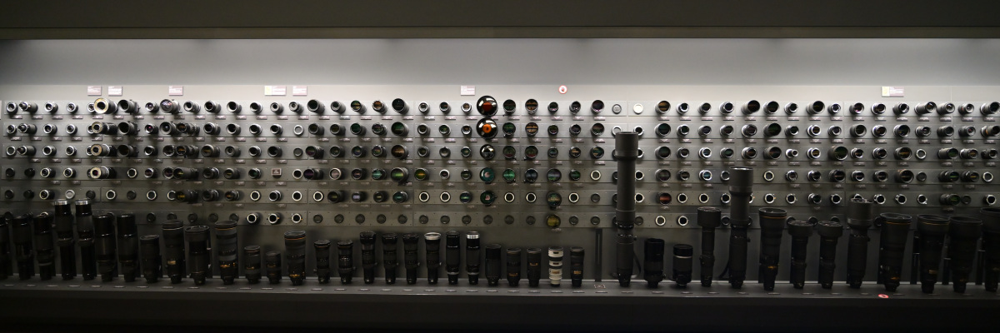

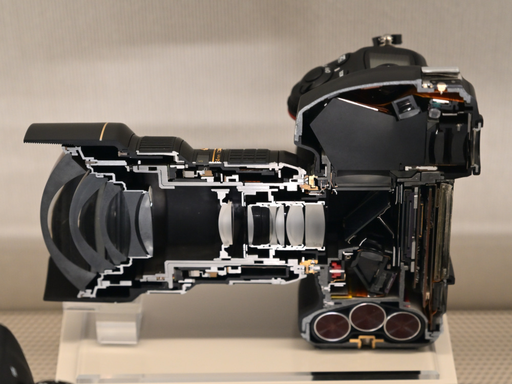

Nikon Museum無需預約，可以免費進入參觀。不過如果需要人員講解，需提前3天在官網申請，而且有中文講解！博物館的動線盡頭，是官方紀念品商店。當然了，我缺的是周邊嗎？我缺的或者說期待著的，是Nikon收購RED之後即將推出的一系列新的電影機設備。不過最後，自己還是選了幾件Nikon Museum紀念品，才捨得離開這裡。

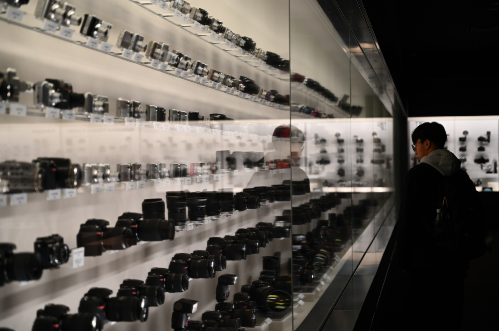

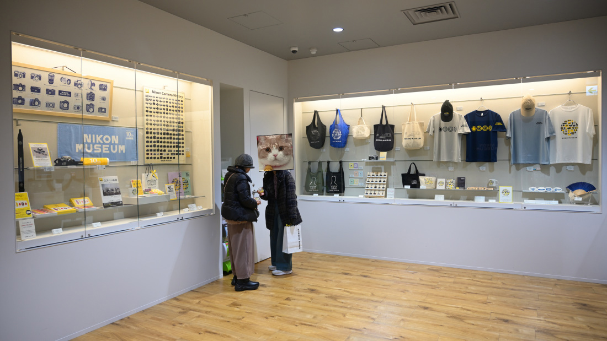

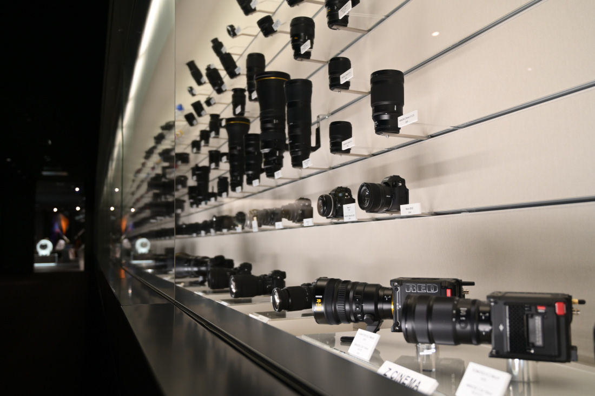
