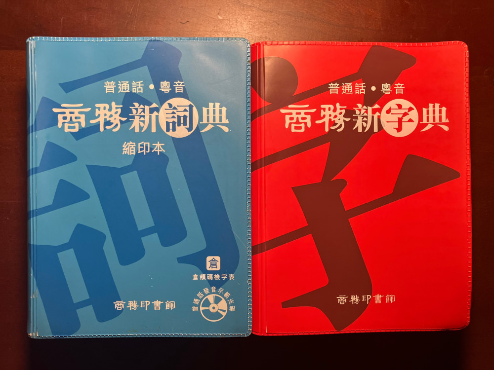

香港业务多了，有时候也会用到繁体字。

比如表达英文的“log in”，我们习惯“登录”、“登陆”混用，香港一般用“登入”，而“登錄”一般對應register，“登陸”限于描述军事和气象。

再一个，简体统一用“里”，香港繁体区分为“裏”和“里”，台湾正体区分为“裡”和“里”。“裏”和“裡”，前者是“衣”字上下拆开，后者直接将“衣”取为偏旁。查了几种说法，有说“裏”更古一些。

“帐（帳）”和“账（賬）”，似乎都有混用的趋势。《咬文嚼字》还是谁好像也研究过。我自己的习惯，能用“帐”就不用“账”——虽然“账户”的写法压倒性居多。

语言文字当然是会变化的，不用刻意泥古；普及简体字，大幅提升了全民教育水平，也是功德无量。今天大部分人对简繁字能做到无师自通，但阻碍进一步交流的，我觉得可能一则是夸大了不同社会建构要素间的对立，二则是对传统历史的态度不同。

