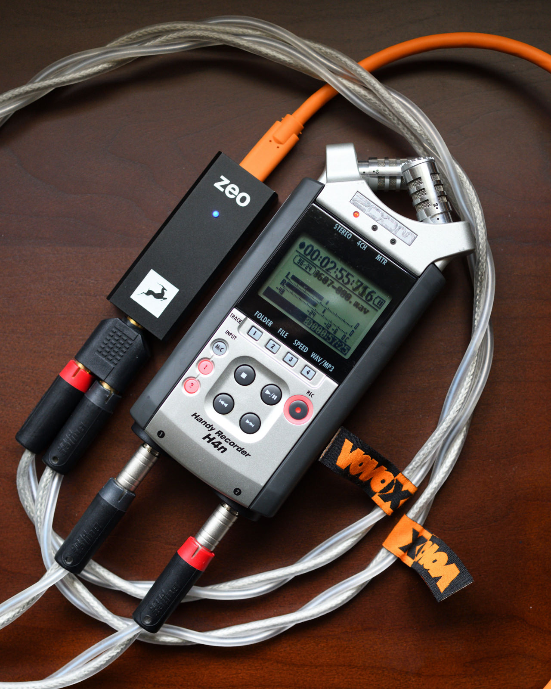

# 1.電源

i.上海普通社區，標準入戶線，國產弱電箱和二線空氣開關

ii.牆內電線：國產起帆2.5mm²，單支銅

iii.牆插：德國ABL「小藍」，美標，單位

iv.排插：日本Panasonic WCH2334，美標，原廠3米美標電源線

# 2.音源

i.Macmini3,1(2009)，外置電源及梅花尾供電，Phino 18awg美標電源線；硬盤更換為Sandisk SSD 240GB；內存更換為三星金條 1066MHz DDR3 2G*2

ii.Macmini6,2(Late 2012),日本Oyaide EM15 8字尾電源線 1.5米；硬盤更換為鎂光Crucial M4 SSD 256GB；內存更換為Hynix 1600MHz DDR3 8G*2

iii.Mac Studio(初代，M1 max,原裝硬盤及64G內存)，Phino 18awg美標電源線

# 3.軟體

i.Macmini3,1(2009): Mac OS 10.6.8 Snow Leopard, Tim Murison開發的BitPerfect v2.0.1 Snow Leopard定製版（未公開下載，能同時支持Hog獨佔模式和Integer Mode整數模式）

ii.Macmini6,2(Late 2012): Mac OS 10.9.5 Mavericks, BitPerfect v1.0.8（能同時支持Hog獨佔模式和Integer Mode整數模式）

iii.Mac Studio(初代，M1 max,原裝硬盤及64G內存): Mac OS 14.8.7 Sonoma, BitPerfect v3.2.0

# 4.解碼DAC

i.美國羚羊 Antelope ZEO

ii.德國Lindy USB2.0 A-C 0.5m，USB2.0 Type-C 1m，Anthra系列各一條

# 5.揚聲器

i.芬蘭真力 Genelec M030

ii.電源線：日本Oyaide EM15 8字尾電源線 1.5米*2

iii.RCA信號線：德國Sommer Albedo MKii 1.5米*2，配HICON CM06 鍍金端子；台灣便利電eze RCA-3.5轉接端子

iv.未安裝腳架和避震配件；僅使用澳洲Blu-Tack藍丁膠將音箱固定在電視機櫃上

# 6.耳機

i.德國森海塞爾 Sennheiser HD 25 light，原廠耳機線

另外，VOVOX Initio IC digital 110Ω AES/EBU 2M, Amphenol XLR connectors，因為沒有XLR輸出的解碼DAC，暫時閒置。
