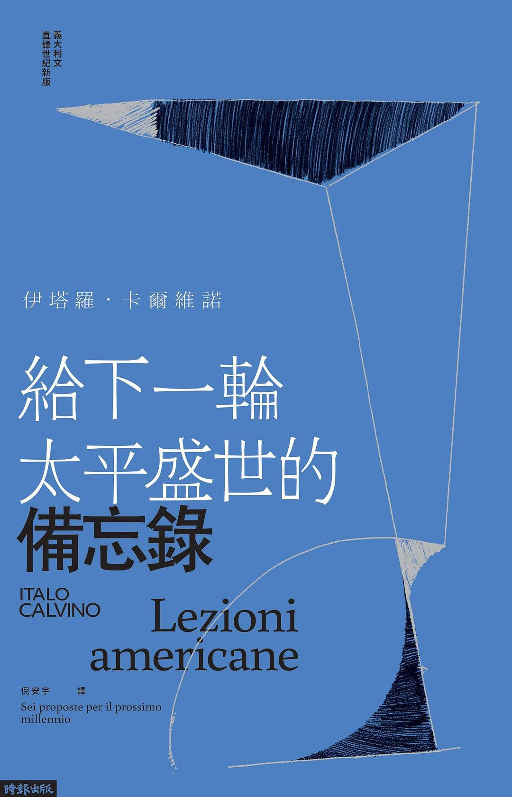

時報出版的倪安宇譯本不錯，而且收录了之前没公开的第八讲笔记。辽宁教育出版的杨德友译本，从英译本翻译的，也可。相比之下，萧天佑的译本每次我都读不了三行。卡尔维诺本人在去世前确定这本书的英文书名是Six memos for the next millennium，杨译“未来千年文学备忘录”真是惊艳，淡化了千禧年而强调了卡尔维诺原话“我指的是文学”；台译将next millennium译作“下一輪太平盛世”，透着一股上行年代的乐观精神；至于萧天佑版译作“美国讲稿”，说起来是根据卡氏夫人起的意大利初版书名Lezioni americane，但不觉得班味很重么？黄灿然的译本，没读过。
