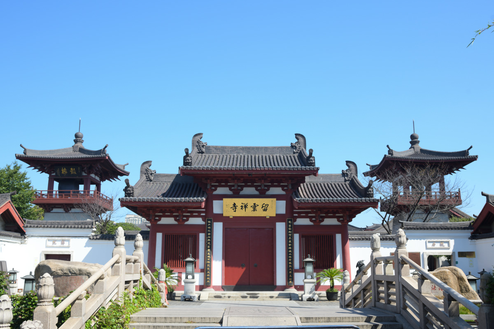
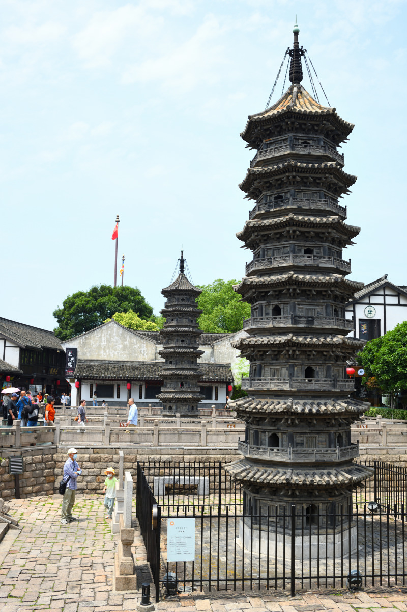
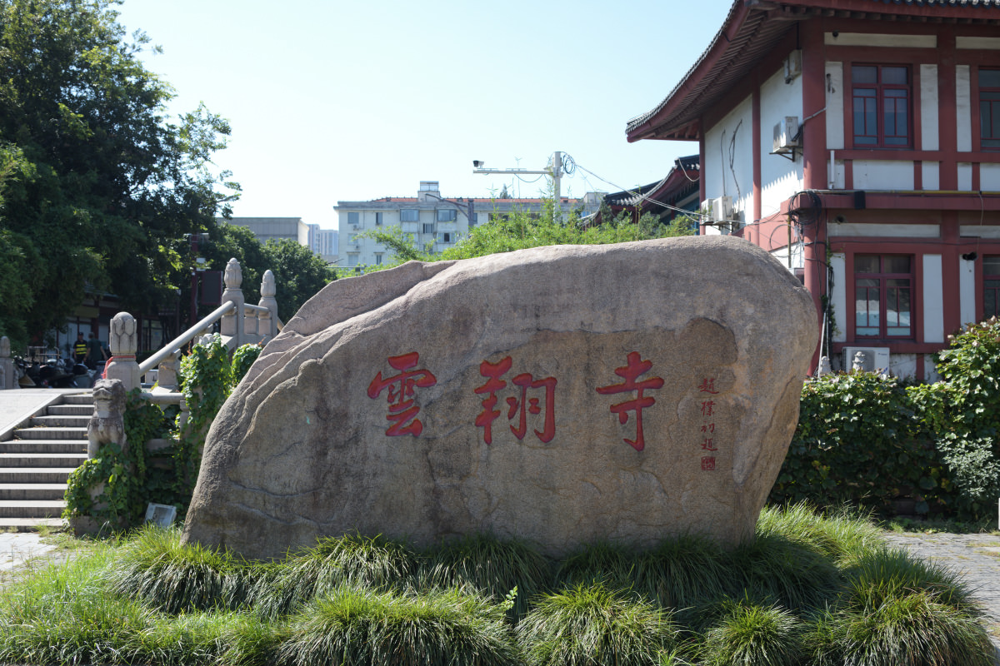
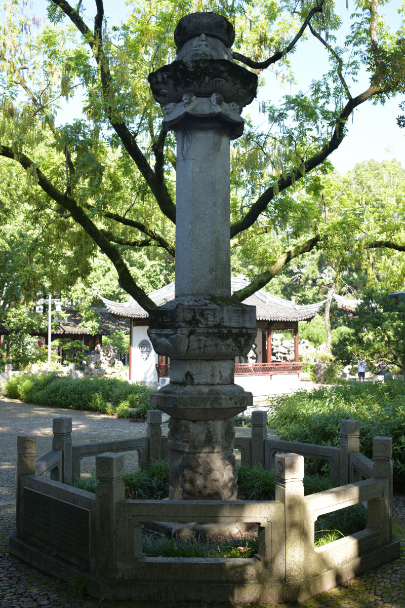
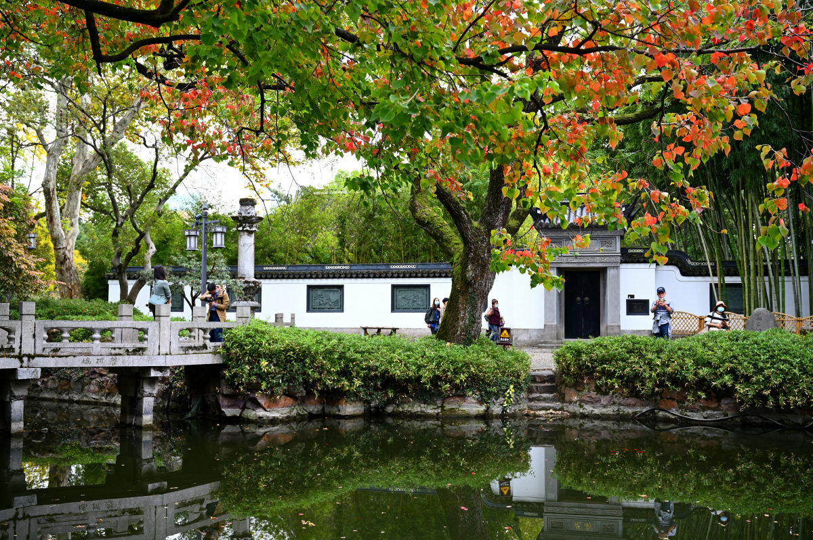
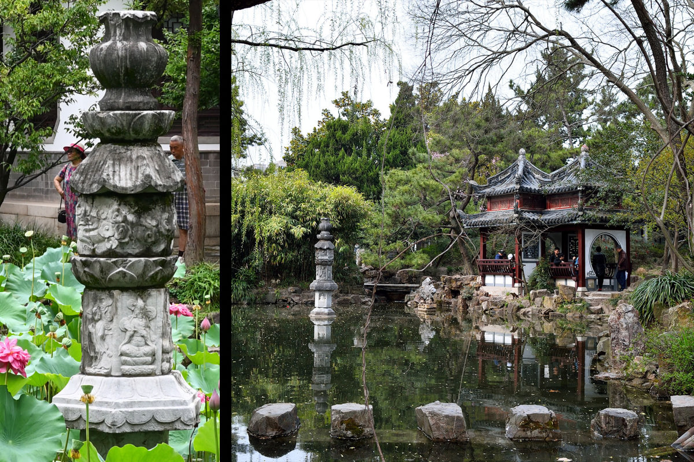
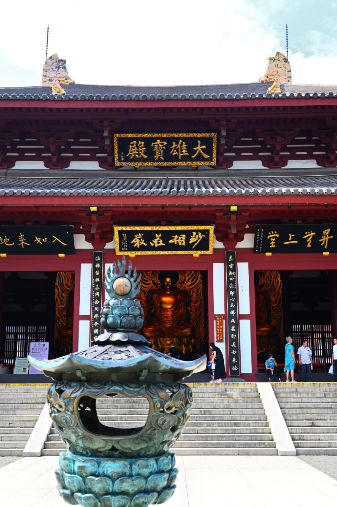
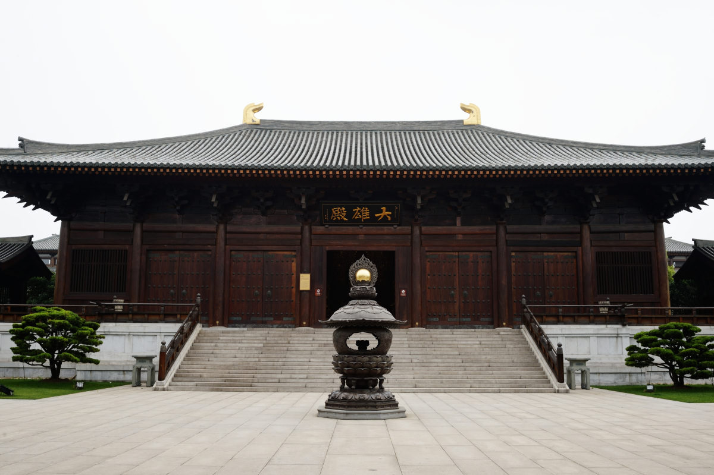
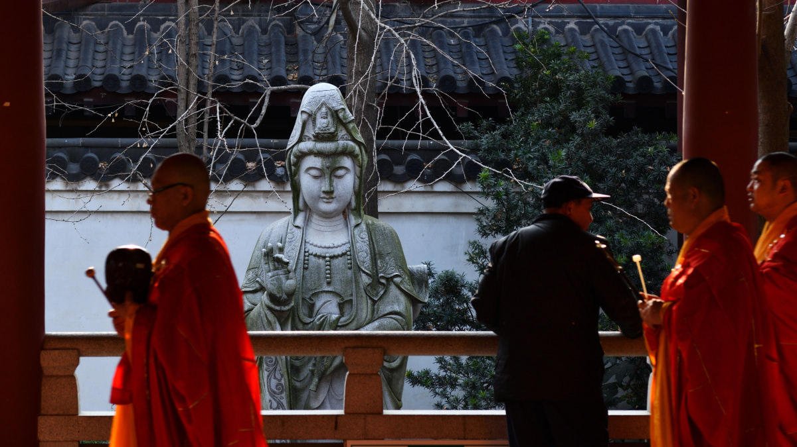

廣為流傳的上海三大叢林，通常指龍華、靜安、玉佛。至於誰排老四則各有擁躉——法華禪寺，真如寺，法藏講寺，呼聲都很高。

幾乎沒有人力推嘉定南翔寺，頗有閒雲野鶴之感。而且它還有好幾個名字，「白鶴南翔寺」、「雲翔寺」、「留雲禪寺」。今天，這裡的山門匾額是台灣悟明法師（1911-2011）題寫的「留雲禪寺」，山門外的石碑上是中國佛教協會會長趙樸初居士題寫的「雲翔寺」。

但上海人乃至全國人民都熟悉「南翔」二字。遠近聞名的上海小籠包，民間皆以其原產地「南翔」為正宗。我並不是南翔人，但網名跟南翔實在太有關聯，所以偏愛用「南翔寺」來稱呼這座傳奇古剎。

論歷史，南翔寺相當悠久，傳說始建於南朝梁天監年間（505），由德齊和尚募化所建——因當地農民耕種時掘到一塊一丈巨石，而後就有兩隻白鶴從天而降，被視為佛兆，佛寺建成後，白鶴即向南飛走，再未回來。由此得名「白鶴南翔寺」。唐開成年間（836-840），行齊和尚募化重修，寺基擴至180畝，在籍僧伽700多人，儼然大寺風範。

要知道，在通商開埠以前，上海版圖是長江進入東海的極東灘塗，與繁華富庶無關。直到唐天寶年間（751），華亭剛剛獨立縣級建制。幾十年後，南翔寺就發展到這樣的規模，可以說是相當興盛了。

今天古猗園內有兩座唐代經幢，另外還有一座南宋嘉定年間的普同塔，它們都是因古猗園擴建需要，於1959年從南翔寺內遷移過來的。

而現南翔老街的中心位置、南翔寺原址的山門之外矗立著一對五代時期的磚塔——它們是全國現存年代最早的仿木結構樓閣式磚塔。在清乾隆年間的一場大火中，南翔寺被燒毀，幸好磚塔劫後餘生。

杜牧有名句「南朝四百八十寺」，未必是實數。南翔寺因寺成市，商賈雲集，成就過「小小南翔賽蘇城」美譽，已然不虛。但它自己難逃成住壞空，在太平天國東征和抗日期間接連遭到破壞，一度岌岌可危。

一直到世紀之交，南翔寺迎接重生，也等到了另一場戲劇性的因緣。

光緒年間（1876），杭州海潮寺在上海南市創建其下院「留雲寺」，1937年戰亂被毀，直到2001年，曾經少年時出任上海留雲寺外副寺、後遠渡台灣的悟明法師倡議重建留雲寺。而此前的1998年，恢復重建雲翔寺已經政府批准。於是上海佛教界集合眾議，決定雲翔寺與留雲禪寺兩寺合一，在雲翔寺原址西移70米重建。

今天拜訪南翔寺，別人會告訴你，它是江南地區第一座按唐代風格復建的寺廟，你也許很難不把它與另一座唐風寺院寶山寺做比較。南翔寺並未排斥以鋼筋、水泥混凝土仿木建造，寶山寺則堅持全實木全榫卯的古法營造。

但南翔寺恐怕無所謂了，它甚至不在意人們是否還用最初的名字稱呼自己，它默默潛入煙火人間，為沙門賡續法脈。曾經屬於它的古老經幢、磚塔，以及它的新道場，會替後來者留下見證。

