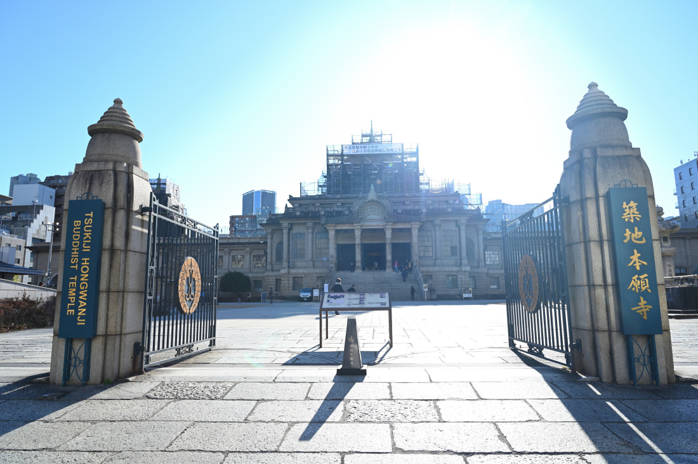
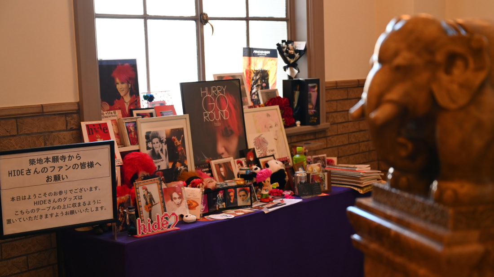
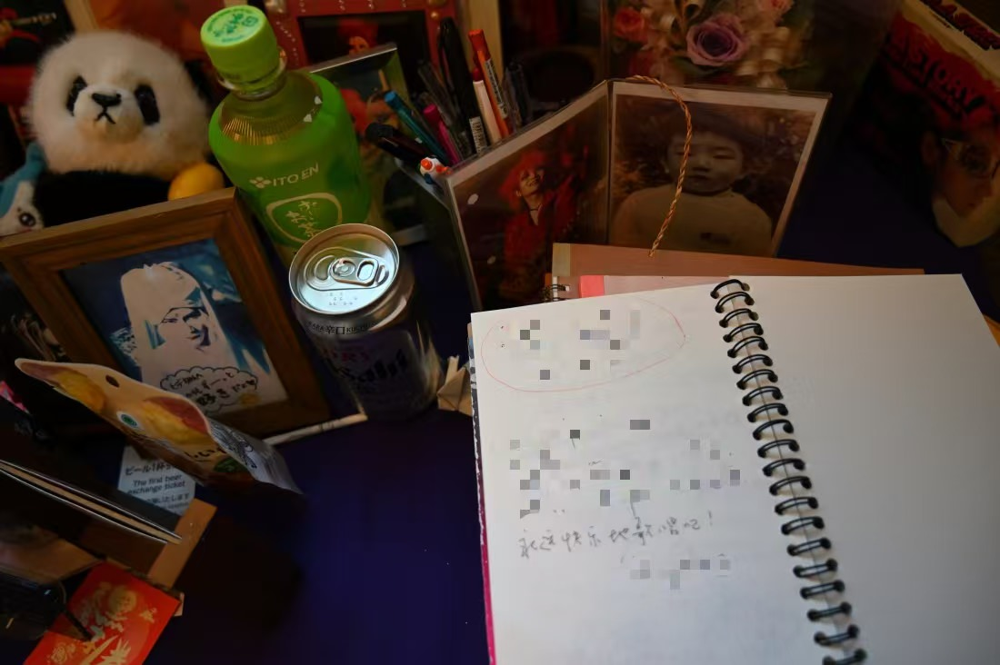

我第一次來東京觀光，下飛機的第一站即是東京都中央區的築地本願寺。

1998年5月2日，原日本傳奇樂團X Japan的主音吉他手松本秀人(hide)意外去世，5月7日其告別式在築地本願寺舉行。根據公開資料，當天有52000多人聚集送殯，隊伍綿延2公里長，是日本演藝圈史上最高的送殯人數，大部分現場群眾情緒失控，數百人暈厥，是當時轟動一時的社會新聞。

第一次聽X Japan的歌，是表妹推薦給我的，連同一起推薦的還有由貴香織里的耽美向漫畫「少年殘像」，「天使禁獵區」。那時候X Japan已經解散多年，但絲毫不影響他們的音樂給我造成了巨大衝擊。我跟表妹一起看X早年的Live光碟錄影時，還一起討論：你喜歡Yoshiki還是hide？其實我都滿喜歡的，Yoshiki的高速擊鼓和古典樂式的編曲很華麗，不過hide的耀眼紅髮、乖張的藝術趣味和良好人格魅力之組合，在東亞文化里更顯得珍貴。

剛剛早上9點，天氣晴朗，我站到築地本願寺正前方，求助起廣場上一位上了年紀的安保，Where is the hide corner？他一開始沒聽懂，隨後我用一串最簡單的英文解釋:hide, rock star, X Japan Guitar...他立刻明白了，讓我跟著他走。

自從1998年5月7日後，築地本願寺為承載歌迷對hide的思念，一直在寺內開放hide corner，起初位於二樓拐角，最近聽說移到了左廳。果然，保安帶我到了左廳（就地理方位而言是東北側廳）入口門，示意我這裡就是，看我還有點沒聽懂的樣子，又重複示意了一次：就在這扇窗的背後。隨後他才折返回自己的崗位，仍不放心地回頭看我，以確認我找到了正確的入口。

左廳似乎是專門承辦白事的房間，hide corner就在它的邊上，照片前方擺滿了歌迷們給hide的「禮物」，還有摞成一疊的留言簿，上面用各種筆跡、各種語言寫滿了給hide的留言。我在最新的一頁，寫下了自己的感謝和祈願：「永遠快樂地歌唱吧！」

