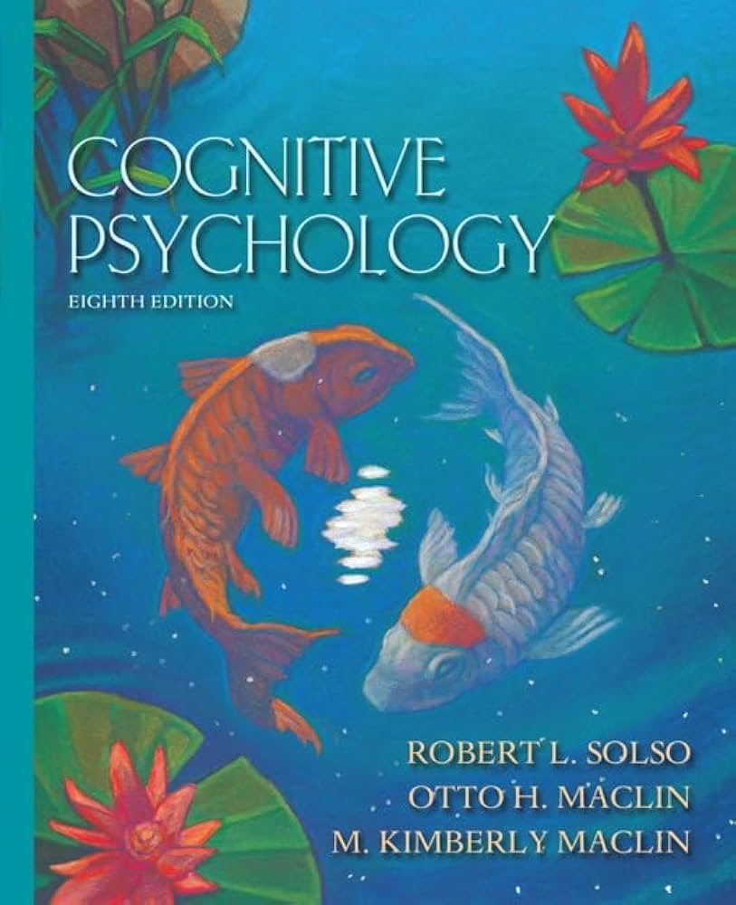

作为一个非心理学专业，而又对心理学感兴趣的人，我希望找到一本合适的入门教材，来打开对认知心理学的认识。虽然今天的图书市场上能找到很多本认知心理学的教材，但索尔所主编的这本读来最为过瘾。

有几个印象特别深刻的地方：

1、索尔所对认知心理学的各种流派、历史、局限性都了如指掌。在开始信息加工模型的具体章节前，对“人类心智”的本质做了简洁而优雅地讲解，并独树旗帜地将人工智能列为最后一章，将人类的知觉、记忆、思维和语言能力与计算机的未来发展做了大一统的融合。

在AI迎来新一轮发展高潮之际，重读这本完稿于2004年的著作，越发敬佩索尔所的远见。

2、写作风格简洁而优雅，非大师而不可能写就。

有兴趣的可能任意对比，Sternberg/Anderson/Goldstein…写的教材。索尔所的讲述方式、知识点编排最有利于了解认知心理学的本质，而不是生硬地列举理论和模型。

3、在保持开阔视野的同时，坚持批判思维

谈「建模」：“在认知心理学崛起的过程中，建模成为心理学家们最乐此不疲的活动，他们也确实创造出了一些很精彩的模型”。

谈「进化心理学」：“尽管对于生活在我们这个星球上的人们来说，社会活动毫无疑问在日常生活中发挥着很大作用，但是深入考察行为和思想的潜在决定因素，也许可以帮助我们更好地理解它们。”

谈「智力」时，首先自我批评道“在心理学中，没有哪个领域的问题比智力和能力的本质更富于争议——这是一个具有重要的社会和政治含义的话题……争议的核心是，一个儿童的智力和能力在多大程度上与其遗传属性有关，又在多大程度上与环境有关。”

谈「Sternberg和Lubart的创造力多元分析理论」：“（理论中的）属性强度以及交互作用的数量，两者结合起来可以形成连科学家都会感到迷惑的复杂网络。事实上，整个理念似乎复杂得有点愚蠢。”

谈「硅基计算机（von Neumann型）与碳基大脑」：“（人类的最大劣势是）信息加工和储存的容量有限；容易遗忘；维护成本昂贵，需要饮食、睡眠、氧气、适宜的温度，还有一整套的生物心理需要，例如爱、归属感、性、摇滚乐和玩游戏的需要。”

需要指出的是，网上一些介绍材料说索尔所是APA的创始人之一，这是不对的。索尔所参与的是美国心理学协会(APS)的创立，另外他确实也是西方心理学协会(WPA)的前任主席。

APA是美国心理学会，全称The American Psychological Association，成立于1892年。人尽皆知的马斯洛、津巴多都做过APA的主席。APA的会员人数众多，且自二战后逐渐倾向于应用心理学，基础心理学逐渐边缘化，因此在1988年，由APA前任主席和一部分著名学者发起成立新组织，也就是现在的APS（美国心理科学协会，Association for Psychological Science）。因此索尔所应当被视作为APS的创始人之一。

索尔所教授已经于2005年离世。目前这套教材已经出到第8版，希望未来能一直修订下去，成为经典。

最末再啰嗦两句人工智能。索尔所在2004年时就为平行分布式加工(PDP)大书特书，为它写了好几个章节，而PDP就是今天的AI教材中的「联结主义/神经网络」。联结主义和早期AI主流的符号派，有点像认知心理学里的自下而上加工、自上而下加工，在哲学里又像是经验主义与理性主义。这几年间AI产业再度复兴，语音识别和视觉识别都是靠使用统计学派方法突飞猛进，靠通过多层神经网络（层数一多就成了“深度学习”）配合反向传播算法和大量数据来求解人的认知结果；逻辑派又一次跌进谷底，因为没法模拟认知过程。当然，认知的结果，并不等同于认知的过程也是一致的，人类认知与AI仍然有着本质的不同。当索尔所贯穿于这整本教材的核心理念教会我这一点时，当真是感觉到它熠熠生辉了。

关于人工智能的来龙去脉，尼克《人工智能简史》、Russell与Norvig合著的《人工智能：一种现代的方法》都是力推。明斯基的《心智社会》、平克的《心智探奇》，在西方既不主流，也存有争议，直接上手看容易被带跑偏。啊～自己吐个槽，公共知识分子在其专业领域外大多不靠谱。
