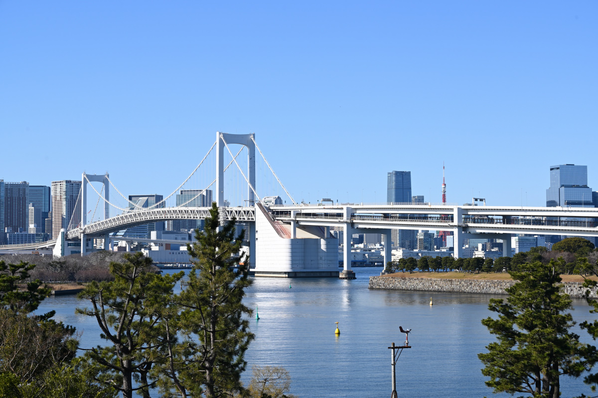
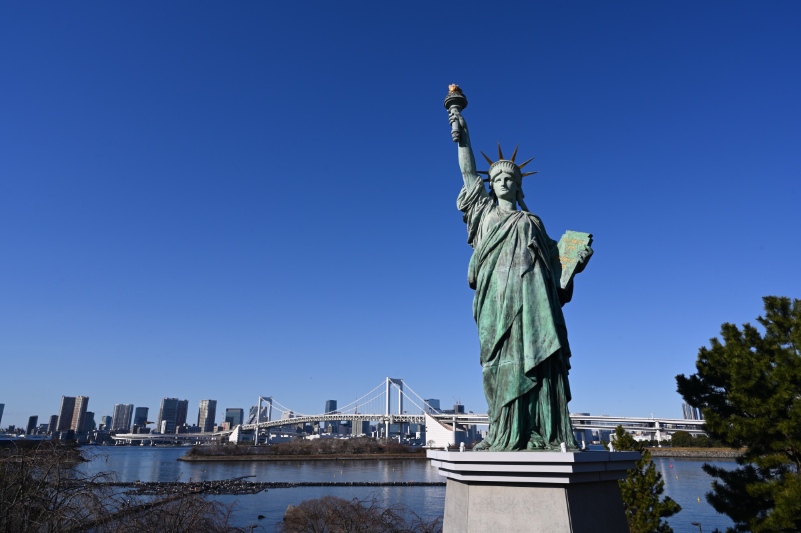
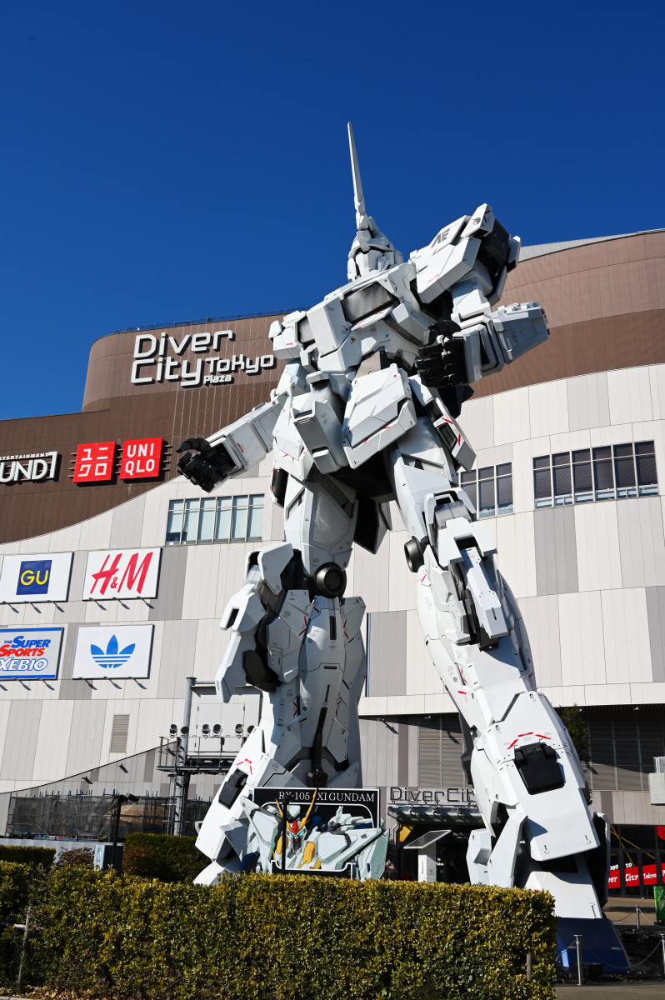
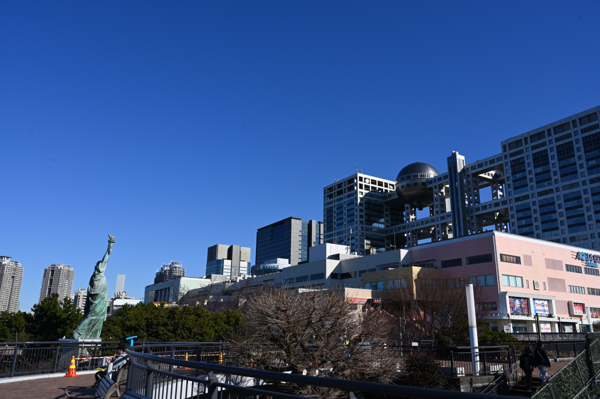
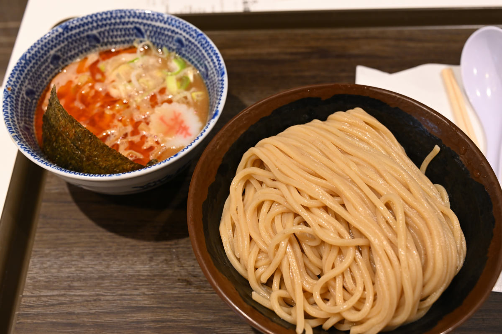
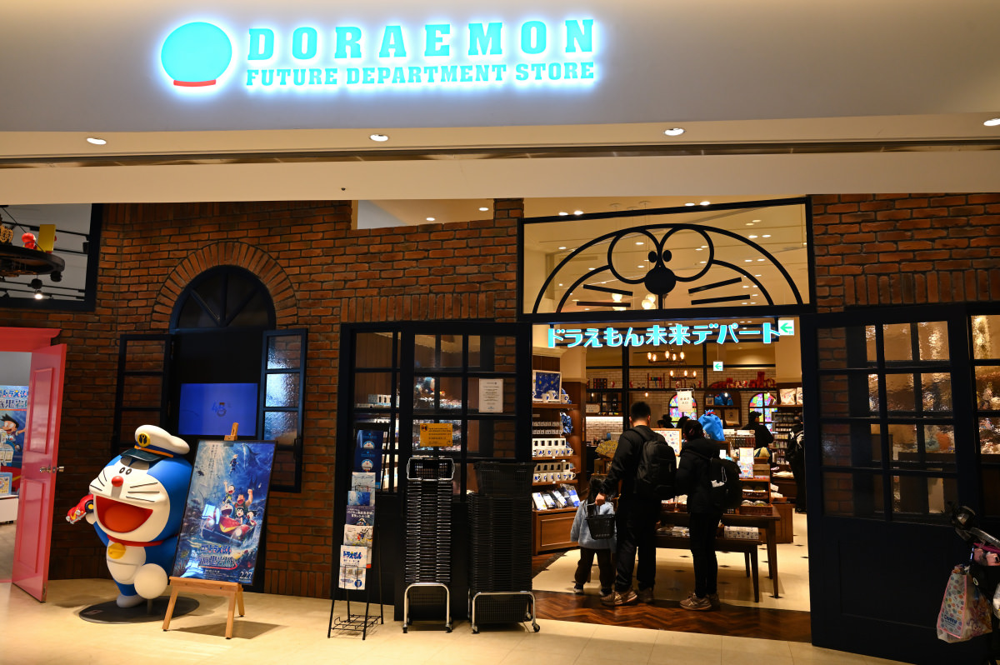

天空和海洋，是一對美麗的組合。如果還有橋，那簡直是人間勝境。

豐洲-台場，就值得如上的褒揚。

從品川區的Nikon總部出發，前往東京灣的晴空與海面的交界處，初衷是奔向台場DiverCity前的鋼彈立像「獨角獸」(RX-0)，卻也順道體會到了，海風是如何從大都會的一側、穿過彩虹大橋和自由女神像的火炬，最後輕拂過行人的臉龐。

在DiverCity的美食廣場，點了一份海老（蝦味）限定蘸麵，好讓當地海味的記憶更深刻一些。對了，豐洲海鮮市集，就在附近。

但豐洲-台場更出名的，是人工填海造陸的未來者精神。不遠處的富士電視台本社大樓，由建築師丹下健三設計，銀色大球充滿了古典科幻感。日本科學未來館、頂尖數位藝術館TeamLab，仔細逛的話一天都不夠。時值2026年1月，散落在全球各地的尚有3座1：1等高的GUNDAM立像，包括福岡、上海、東京。作為鎮守東京都的MS，「獨角獸」因為全身搭載精神感應框架並啟動了NT-D系統，具有干涉時空與因果的能力，通常被認為UC紀元的戰力王者，也折射出東京都的另一面科幻氣質。

離開時選擇了百合海鷗線，凌空式的軌道讓你360度沈浸在湛藍的天與海水中間。不知不覺，就從年輕的海島，抵達到大都市的心臟了。

